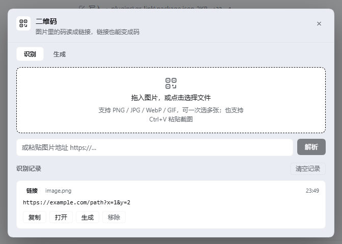
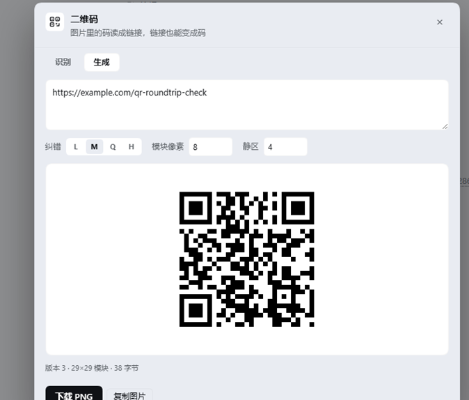
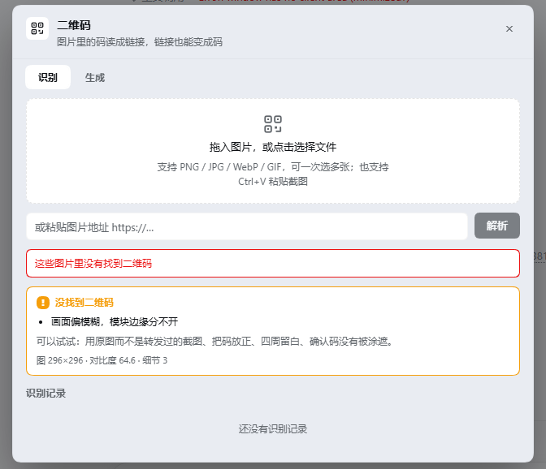

# dsh-qr-link

[](https://github.com/awesome-dsh-plugin/awesome-dsh-plugin)

QR codes in both directions for the DeepSeek Harness Web UI: read the link out of an image, or turn any link into a code. Everything runs in the browser session — no upload, no network call, no external binary.



## What it does

**Decode.** Drop, paste or pick an image that contains a QR code and get the payload back with a type badge (link / text / WiFi / email / phone / SMS / contact), plus copy and open actions and a local history. Entry points are drag-and-drop, file picker, `Ctrl+V` on a screenshot, and an image URL.

**Explain.** When nothing is found, it does not stop at "no QR code here" — it measures the frame and names the actual problem (see below).

**Encode.** Type a link or any text and a QR code appears as you type. Error correction L/M/Q/H, 2–24 pixels per module, 0–12 modules of quiet zone, then download as PNG or copy the image to the clipboard.



## Why the failure diagnosis exists

`jsQR` either returns a payload or nothing. For a screenshot that is fine; for a photograph it leaves the user guessing. This plugin measures four properties of the frame and reports what they mean:

| Measurement | How it is computed | What it reports |
|---|---|---|
| Contrast | standard deviation of luma | code and background blend together |
| Detail | Laplacian variance on a downscaled copy | frame is blurry, module edges merge |
| Quiet zone | fraction of dark pixels inside a 2 % border band | the code was cropped into its white margin |
| Ink coverage | fraction of pixels below `mean − 24` | light code on a dark background, or an over-dark frame |

Eight verdicts come out of this: flat image, too small, low contrast, blurry, cropped quiet zone, dark frame, no dark ink, and generic. The panel prints the raw numbers under the verdict — `image 296×296 · contrast 64.6 · detail 3` — so the message is checkable instead of a guess.



The thresholds were tuned against eleven constructed samples: a clean code, the same code with its quiet zone removed, light and heavy Gaussian blur, an inverted code, flat white, flat grey, random noise, a low-contrast code, and a photographic gradient.

## What actually improves the hit rate

Before giving up, the decoder retries with two binarizations that jsQR does not attempt on its own: a global Otsu threshold and a block-adaptive one (mean of a local window minus a margin).

Measured: a code rendered at contrast 18.5 (grey-on-grey) fails on raw pixels and is recovered by **both** binarizations. Uneven lighting, phone screenshots and faded print are the cases this exists for.

## Install

```bash
dsh plugin --profile web add dsh-qr-link
```

or straight from the repository:

```bash
dsh plugin --profile web add github:392138239-pixel/dsh-qr-link
```

Then open the QR button in the composer tool row (left side, next to the permission control).

## Where it lives in the UI

- a 28 px button in `conversation.input.left`
- a dialog in `shell.overlay` with two tabs

Nothing is written outside the plugin's own localStorage key (`dsh.qrlink.history.v1`, capped at 60 entries).

## Privacy

No network requests. Decoding and encoding both happen in the page with bundled JavaScript. An image URL is the only case where the browser fetches anything, and only the URL the user typed.

## Compatibility

Requires a DeepSeek Harness build that exposes `conversation.input.left` and `shell.overlay` — 0.2.x Web UI. No peer dependencies on `@deepseek-ai/*` packages: the client half uses the host React from the module table and the host's theme tokens for styling.

## Third-party code

Two cores are bundled unmodified into `client.js` (359 KB total):

| Package | Version | License | Use |
|---|---|---|---|
| [jsQR](https://github.com/cozmo/jsQR) | 1.4.0 | Apache-2.0 | decoding |
| [qrcode-generator](https://github.com/kazuhikoarase/qrcode-generator) | 1.4.4 | MIT | encoding |

Full license texts: `LICENSE-jsQR.txt`, `LICENSE-qrcode-generator.txt`.

## License

MIT — see `LICENSE`.

---

[中文说明](README.zh.md)
