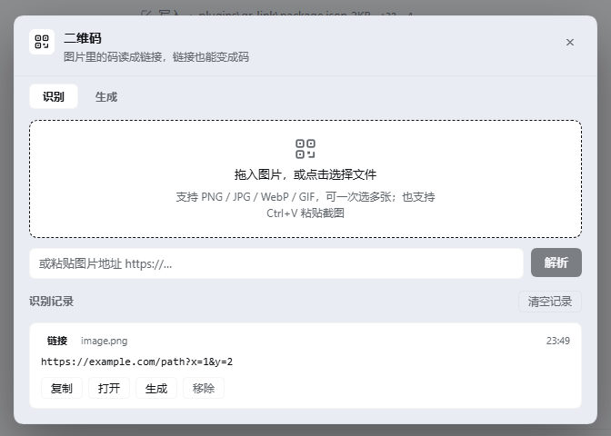
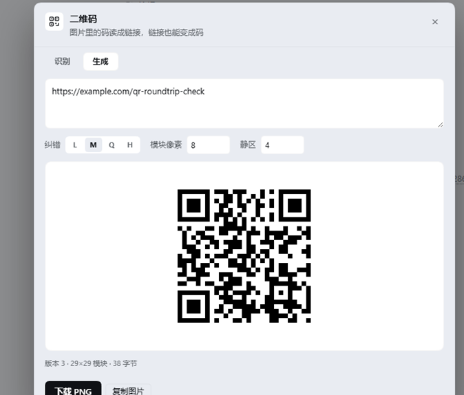
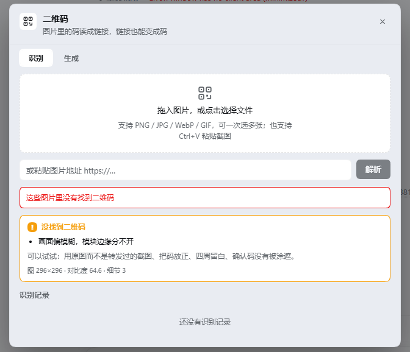

# dsh-qr-link

DeepSeek Harness Web UI 的二维码插件，双向：把图片里的码读成链接，也能把链接变成码。全部在浏览器里跑——不上传、不联网、不依赖任何外部程序。



## 两个能力

**识别。** 拖入、粘贴或选择一张带二维码的图片，得到内容并标出类型（链接 / 文本 / WiFi / 邮件 / 电话 / 短信 / 名片），可以复制、打开，记录存在本地。入口有四个：拖拽、选文件、`Ctrl+V` 粘截图、图片地址。

**说明。** 找不到码时不只丢一句"没有"，而是先量图再下结论（见下）。

**生成。** 输入链接或任意文字，边打边出码。纠错 L/M/Q/H、模块像素 2–24、静区 0–12 可调，可以下载 PNG 或直接复制图片到剪贴板。



## 失败诊断在算什么

`jsQR` 只返回结果或不返回。截图够用，照片就会卡住——用户不知道该改哪里。这个插件量四个量：

| 指标 | 算法 | 用来说明 |
|---|---|---|
| 对比度 | 灰度标准差 | 码和背景糊在一起 |
| 细节量 | 缩略图上的拉普拉斯方差 | 画面模糊、模块边缘分不开 |
| 静区 | 四周 2% 边框带内暗像素占比 | 码被裁进了白边里 |
| 着墨率 | 低于「均值−24」的像素比例 | 浅色码深色底，或整张过暗 |

由此判定 8 类原因：纯色、太小、低对比度、模糊、静区被裁、整体偏暗、没有深色墨、通用。面板会把原始数字印在结论下面——`图 296×296 · 对比度 64.6 · 细节 3`——结论可复核，不是猜的。



阈值是拿 11 张构造样本调的：干净码、裁掉静区的码、轻/重高斯模糊、反色码、纯白、纯灰、随机噪点、低对比度码、渐变照片。

## 真正提高识别率的部分

放弃之前会换两种二值化再试一遍，这是 jsQR 自己不会做的：全局 Otsu 阈值，和分块自适应阈值（局部均值减一个余量）。

实测：一张对比度只有 18.5 的灰底灰码，原生像素解不出，**两种二值化都能救回**。不均匀光照、拍屏幕、褪色印刷都属于这一类。

## 安装

```bash
dsh plugin --profile web add dsh-qr-link
```

或直接从仓库：

```bash
dsh plugin --profile web add github:392138239-pixel/dsh-qr-link
```

装完点输入框左下角（权限控件旁边）的二维码按钮。

## 界面位置

- `conversation.input.left` 里一个 28 px 按钮
- `shell.overlay` 里一个双标签对话框

除了自己的 localStorage 键（`dsh.qrlink.history.v1`，最多 60 条）之外不写任何地方。

## 隐私

不发网络请求。编码解码都在页面里用内置 JavaScript 完成。唯一的联网是用户自己输入图片地址时，浏览器去取那个地址。

## 兼容性

需要暴露 `conversation.input.left` 与 `shell.overlay` 的 Harness 构建——0.2.x Web UI。不依赖任何 `@deepseek-ai/*` 包做运行时依赖：前端用模块表里的宿主 React，样式走宿主的 theme token。

## 第三方代码

两个核心原样内联进 `client.js`（合计 359 KB）：

| 包 | 版本 | 许可 | 用途 |
|---|---|---|---|
| [jsQR](https://github.com/cozmo/jsQR) | 1.4.0 | Apache-2.0 | 解码 |
| [qrcode-generator](https://github.com/kazuhikoarase/qrcode-generator) | 1.4.4 | MIT | 编码 |

许可全文见 `LICENSE-jsQR.txt`、`LICENSE-qrcode-generator.txt`。

## License

MIT，见 `LICENSE`。

---

[English](README.md)
